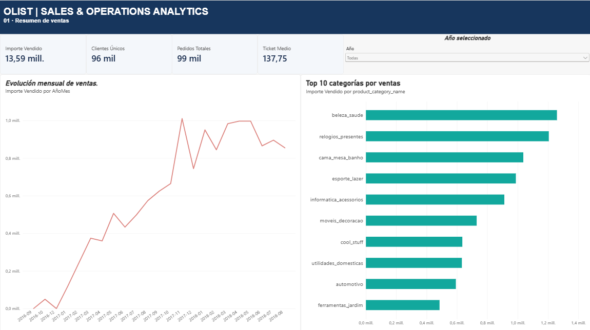
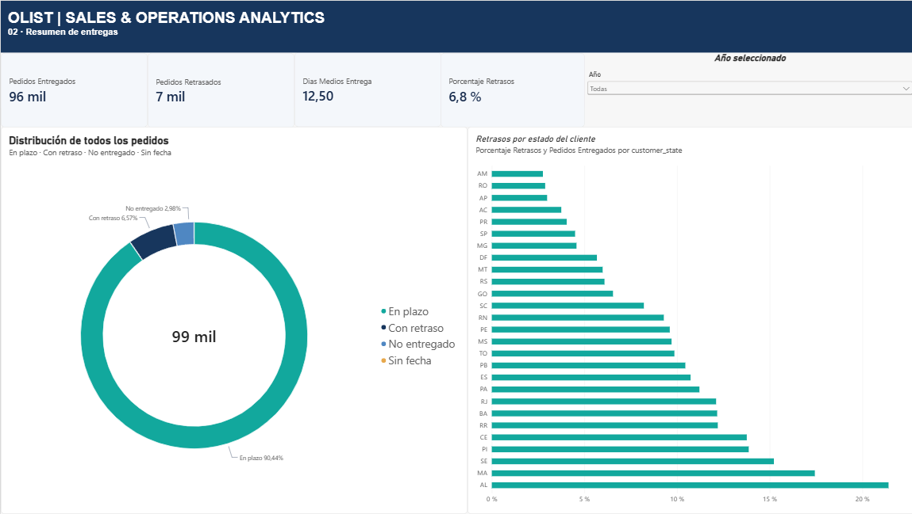
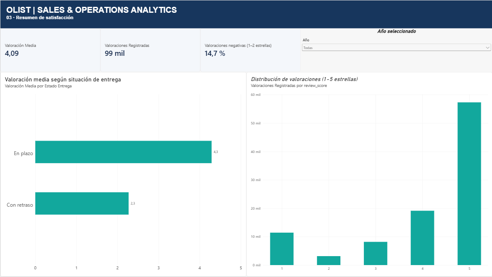
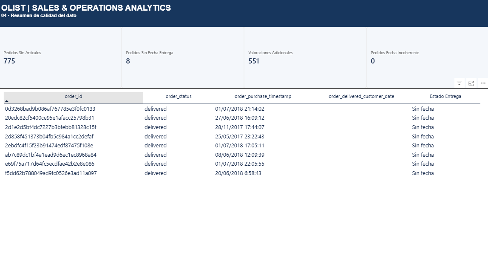
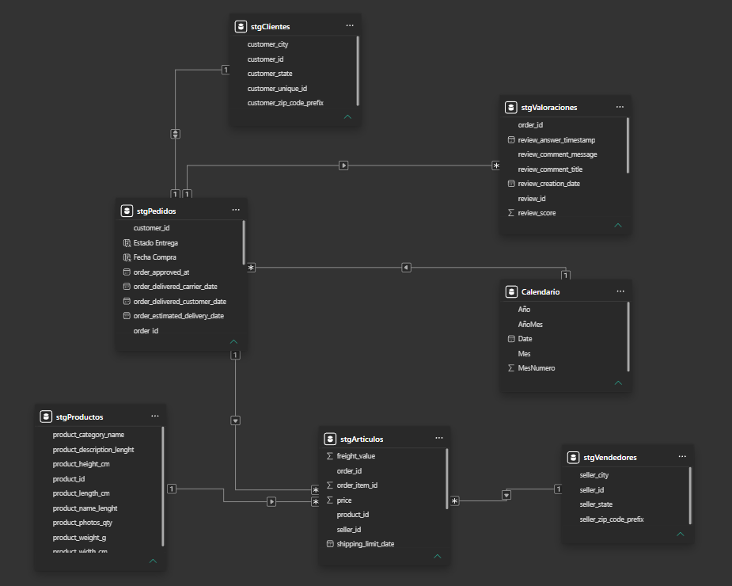

# Olist Analytics | Power BI

Proyecto personal para practicar análisis de datos con un caso de comercio electrónico. He utilizado el dataset público de Olist (Brasil) para preparar varias tablas, relacionarlas y construir un dashboard de ventas, entregas, satisfacción y calidad del dato.

La idea era ir más allá de montar gráficos: quería entender qué representa cada dato, comprobar los cálculos y documentar el trabajo.

## Qué incluye

| Página | Qué se puede consultar |
| --- | --- |
| **Ventas** | Importe de artículos, pedidos, clientes únicos, ticket medio, evolución mensual y principales categorías. |
| **Entregas** | Pedidos evaluables, retrasos, plazo medio y diferencias entre estados de Brasil. |
| **Satisfacción** | Distribución de puntuaciones de 1 a 5 y comparación entre entregas puntuales y retrasadas. |
| **Calidad del dato** | Fechas ausentes o incoherentes, pedidos sin artículos y valoraciones adicionales. |

### Entregas

### Satisfacción

### Calidad del dato

## Cómo lo he construido

- **Power Query:** importación de CSV y revisión de fechas, identificadores e importes. Tuve que corregir la interpretación de los decimales usando la configuración regional adecuada.
- **Modelo de datos:** relaciones entre pedidos, artículos, clientes, productos, vendedores y valoraciones; además de un calendario para filtrar por fecha de compra.
- **DAX:** medidas para ventas, pedidos distintos, ticket medio, porcentajes de retraso, días de entrega y valoraciones.
- **Comprobaciones:** página adicional de pruebas para contrastar recuentos y revisar indicadores.
- **Jira y Confluence:** documentación posterior del desarrollo y planificación de las mejoras pendientes. Es un proyecto individual, no un trabajo realizado dentro de un equipo Scrum.

## Comprobaciones realizadas

| Dato | Registros |
| --- | ---: |
| Pedidos | 99.441 |
| Líneas de artículos | 112.650 |
| Valoraciones | 99.224 |
| Pedidos diferentes valorados | 98.673 |
| Registros de valoración adicionales | 551 |

Encontré también ocho pedidos marcados como entregados sin fecha de entrega y 775 pedidos sin artículos asociados. No he eliminado estos registros automáticamente: algunos casos pueden tener una explicación válida.

## Abrir el proyecto

1. Descarga el archivo [`powerbi/Olist_Analytics.pbix`](powerbi/Olist_Analytics.pbix).
2. Ábrelo con **Power BI Desktop**. El informe conserva los datos importados en el momento de guardarlo.
3. Para actualizar las consultas, descarga los CSV desde el [dataset público de Olist](https://www.kaggle.com/datasets/olistbr/brazilian-ecommerce) y cambia las rutas locales de origen en Power Query. En mi equipo están configuradas bajo `E:\Olist`.

No se incluyen los CSV originales en este repositorio.

## Límites y próximos pasos

El **importe de artículos** suma los precios registrados; no representa ingresos netos de la plataforma ni necesariamente ventas completadas. El **porcentaje de retrasos** utiliza las entregas evaluables como denominador. Las **valoraciones** se analizan por registro, aunque algunos pedidos tienen más de una.

Quiero seguir mejorando la interpretación de pedidos cancelados, estudiar una única valoración por pedido cuando corresponda, aplicar tamaños mínimos de muestra en comparaciones territoriales y ampliar las pruebas. Los datos son históricos; el informe no representa la actividad actual de Olist.

En [`docs/diccionario-metricas.md`](docs/diccionario-metricas.md) explico las principales medidas y sus límites.

**Datos:** Brazilian E-Commerce Public Dataset by Olist. Proyecto personal, sin vinculación con Olist.
