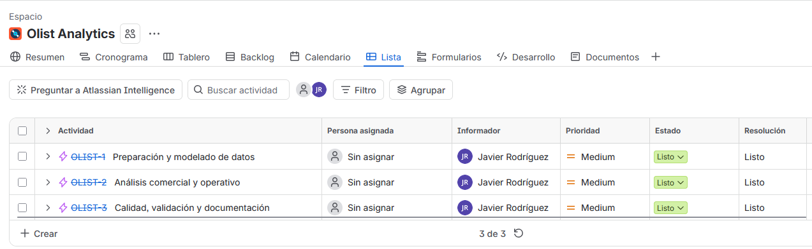
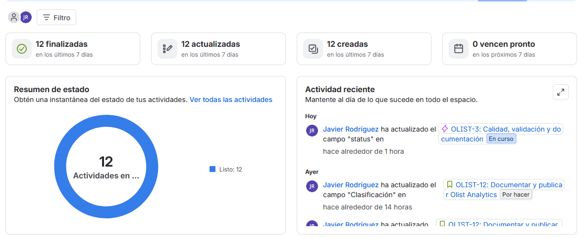
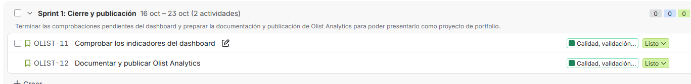

# Organización del proyecto con Jira

[Volver al proyecto](../../README.md) · [Documentación de Confluence](../confluence/README.md)

He utilizado Jira para organizar y documentar el trabajo realizado en Olist Analytics. El proyecto está dividido en **tres épicas y nueve historias**, que recogen la preparación de datos, los análisis de Power BI, las pruebas y la documentación.

La mayor parte del dashboard ya estaba construida cuando empecé con Jira. Registré ese trabajo de forma retrospectiva y utilicé un sprint para gestionar el cierre y la publicación.

## Épicas del proyecto

| Épica | Qué agrupa | Estado al cerrar la primera versión |
| --- | --- | --- |
| OLIST-1 | Preparación y modelado de datos | Listo |
| OLIST-2 | Análisis comercial y operativo | Listo |
| OLIST-3 | Calidad, validación y documentación | Listo |

## Estado final

Al cerrar esta primera versión, las doce actividades quedaron en estado «Listo»: tres épicas y nueve historias. El resumen cuenta ambas, no doce historias independientes.

El cierre corresponde al alcance de esta primera versión. Las limitaciones y mejoras de los indicadores siguen recogidas en el [diccionario de métricas](../diccionario-metricas.md).

## Sprint 1 · Cierre y publicación

Preparé un sprint con dos historias:

| Historia | Trabajo |
| --- | --- |
| OLIST-11 | Comprobar los indicadores del dashboard |
| OLIST-12 | Documentar y publicar Olist Analytics |

Las dos historias se completaron y después cerré el sprint. Su duración prevista era de una semana; eso no significa que trabajara durante siete días completos ni que el desarrollo inicial se hiciera dentro de ese sprint.

*Esta captura corresponde al estado de las historias antes del cierre. Por sí sola no muestra la confirmación de que el sprint se haya cerrado.*

La documentación del cierre está en la [revisión del Sprint 1](../confluence/06-revision-sprint.pdf) y la [retrospectiva individual](../confluence/07-retrospectiva.pdf), exportadas desde Confluence.

## Qué he aprendido

He practicado la creación de épicas e historias, el seguimiento del backlog, los cambios de estado y la planificación y cierre de un sprint.

Para el próximo proyecto quiero utilizar Jira desde el principio y mantener la documentación actualizada mientras avanzo. Es una práctica individual de Agile y Scrum, no un proyecto desarrollado dentro de un equipo Scrum.
